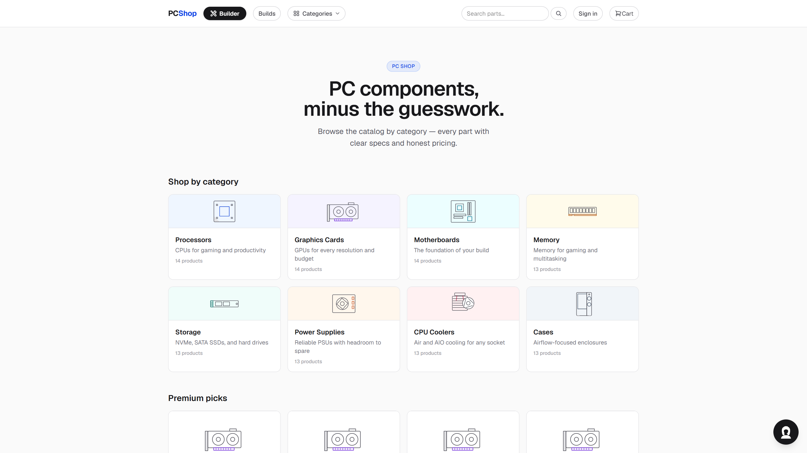
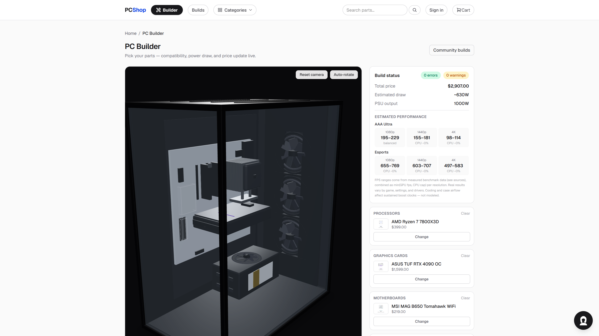
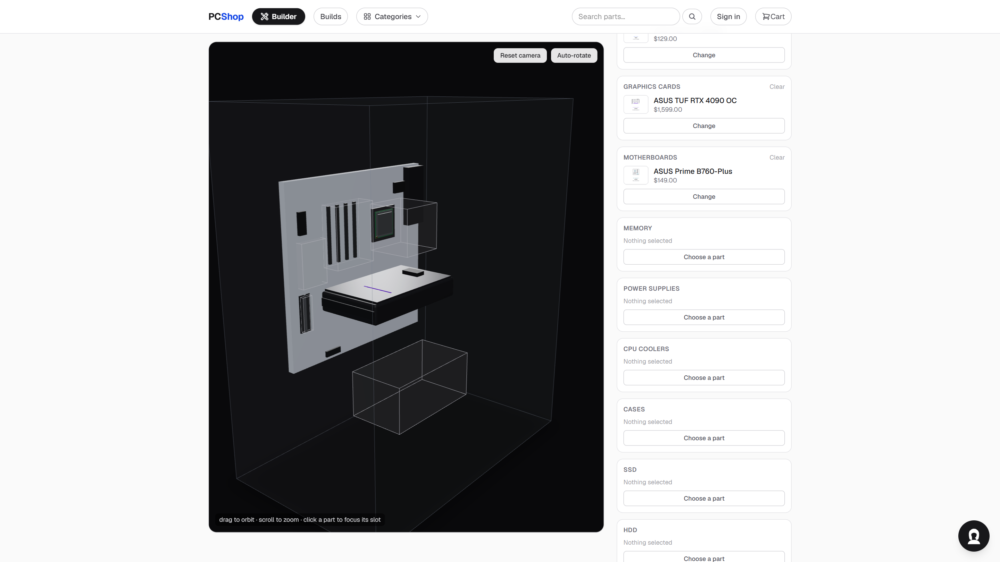
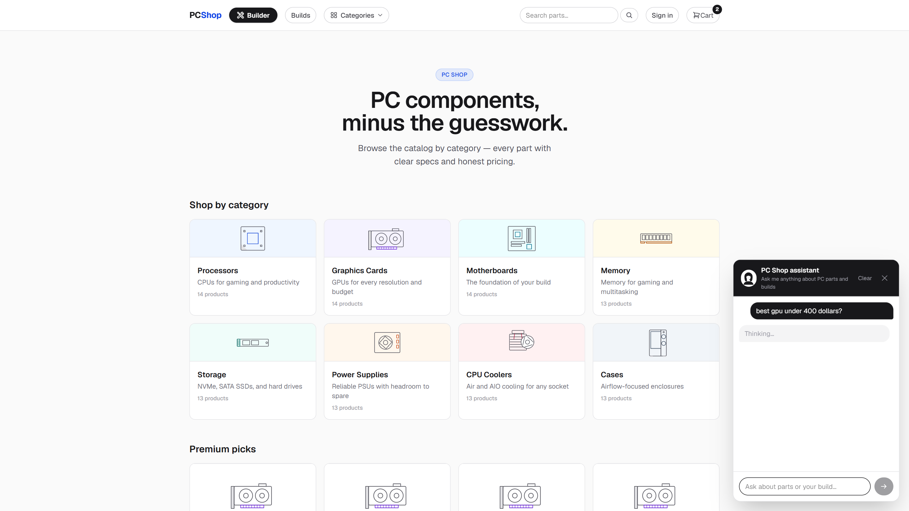
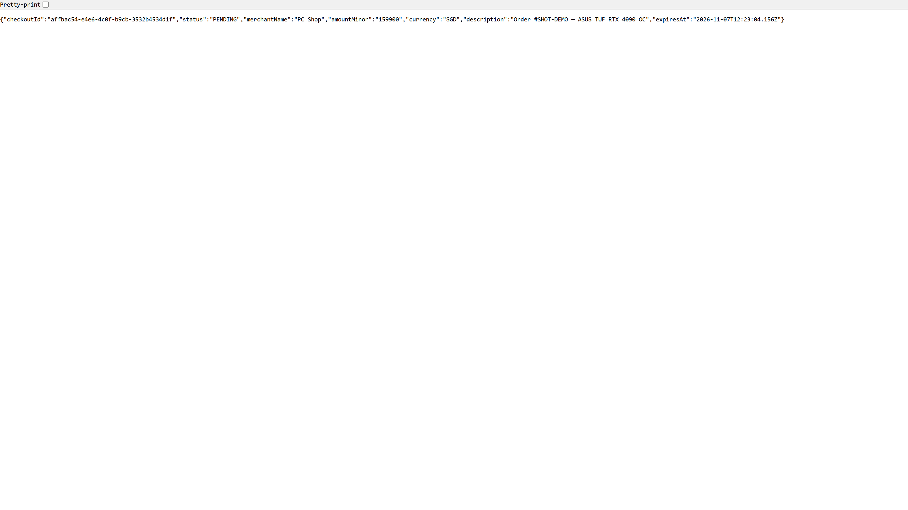

# PC Shop

A full-stack PC-parts store where compatibility, power and honest FPS numbers
are computed live while you build — in 3D.



Pick your parts, spin the rig, and watch the estimate change. A rules engine
catches incompatible builds on every selection, FPS estimates are grounded in
real published benchmarks instead of marketing numbers, checkout runs through
a swappable payment-gateway abstraction, and a catalog-grounded shopping
assistant answers questions with real products and real prices.

## Highlights

**3D build viewer** — every selected part renders as a GLB model inside the
case in a live react-three-fiber scene with orbit controls.



**Benchmark-grounded FPS estimates** — real per-GPU per-resolution averages
(TechPowerUp) combined with CPU gaming ceilings (GPUCheck) through a
`min(GPU, CPU cap)` model. When a 4090 is paired with a budget CPU, the
estimate says so instead of hiding the bottleneck:



**Live compatibility checks** — 12 rules (sockets, DDR4/DDR5, PSU headroom,
GPU clearance, cooler height, chipset/RAM tiers …) run in the browser on every
selection. Incompatible picks pulse red with a plain-English fix; the same
pure functions also back the assistant's tools, so client and server can
never drift apart.

**Catalog-grounded assistant** — a chat powered by any OpenAI-compatible
endpoint (Groq's free tier in dev) with four tools: product search, product
details, compatibility checking and build-performance estimation. The system
prompt forbids stating any spec, price or compatibility claim that didn't
come from a tool result, and answers link to real product pages.



**Swappable payment gateway** — checkout logic is written once against a
two-method provider interface and works unchanged across three backends:
a custom MiniPay gateway (hosted
checkout + HMAC-SHA256-signed webhooks), Stripe test mode, and a local mock
gateway. Webhooks verify signatures over the raw request body and transition
orders `pending → paid` with a compare-and-set guard, so retried callbacks
can't double-resolve.



**Everything else a store needs** — cart, checkout with full server-side
re-pricing (client prices are never trusted), discount codes
(percent/fixed, product-scoped, redemption caps), scrypt-hashed customer
accounts with revocable server-side sessions, an admin dashboard for
products / orders / discounts, and community builds shareable by public link.

## Tech stack

| Layer      | Choices                                                            |
| ---------- | ------------------------------------------------------------------ |
| Framework  | Next.js 16 (App Router, RSC, Server Actions) · React 19 · TypeScript |
| Styling    | Tailwind CSS v4, zinc monochrome palette                            |
| 3D         | react-three-fiber · drei · Three.js (GLB part models)               |
| Data       | SQLite (better-sqlite3) · Drizzle ORM + generated migrations        |
| Payments   | MiniPay gateway · Stripe Checkout (test mode) · local mock          |
| Assistant  | OpenAI-compatible chat completions + tool calling (Groq in dev)     |
| Security   | node:crypto (scrypt, HMAC-SHA256, timingSafeEqual) · httpOnly cookies |

## How it's put together

```
src/
  app/
    (shop)/        catalog, category, product, search, cart, checkout,
                   order, account, build (3D builder), builds (community)
    (auth)/        login / signup (server actions)
    admin/         single-admin dashboard (products, orders, discounts)
    api/           checkout, builds, ai/chat, discounts, mock-pay
    minipay/       callback/        HMAC-verified payment webhook
  components/      client islands: 3D viewer, builder, cart, AI assistant
  lib/             pure business logic — catalog taxonomy, compatibility
                   rules, performance model, orders, discounts, payments, ai
  db/              Drizzle schema (7 tables) + seeds (catalog, benchmarks)
  scripts/         verification: verify-compat, verify-perf, smoke-auth
```

Server components query Drizzle directly for catalog/order/admin pages; the
builder, 3D viewer, cart and assistant are client islands. All business
logic lives in pure `lib/` modules shared byte-for-byte by the browser and
the assistant's server-side tools.

## Getting started

**Prerequisites:** Node.js 20.9+, pnpm 12+.

```bash
pnpm install
cp .env.example .env.local   # fill in what you want (everything optional)
pnpm db:migrate
pnpm db:seed                 # ~100 real components + benchmark data
pnpm dev
```

Open [http://localhost:3000](http://localhost:3000). The SQLite database
lives at `data/pc-shop.db` (override with `DATABASE_PATH`). 3D part models
under `public/models/` are curated GLB files (see [MODELS.md](MODELS.md)).

### Environment variables

| Variable              | Purpose                                                    |
| --------------------- | ---------------------------------------------------------- |
| `STRIPE_SECRET_KEY`   | Enables Stripe test mode when set                          |
| `MINIPAY_BASE_URL`    | MiniPay gateway base URL (`http://localhost:3000` in dev)  |
| `MINIPAY_API_KEY`     | MiniPay merchant API key (X-API-Key header)                |
| `AI_BASE_URL` / `AI_API_KEY` / `AI_MODEL` | Any OpenAI-compatible endpoint; Groq free tier works |
| `ADMIN_PASSWORD`      | Required for `/admin` (single-admin auth)                  |
| `NEXT_PUBLIC_APP_URL` | Public base URL used for payment redirects                 |

With no payment keys configured, checkout falls back to a local mock payment
page — approve or decline, zero setup. No real money moves in any mode.

### Database commands

```bash
pnpm db:generate   # generate SQL migrations from the Drizzle schema
pnpm db:migrate    # apply migrations
pnpm db:seed       # seed catalog + benchmark rows
```

## Verification

Verification scripts run against the real seeded database:

```bash
pnpm verify:compat   # known-good and known-bad builds produce expected findings
pnpm verify:perf     # FPS estimates and bottleneck warnings match benchmarks
pnpm smoke-auth      # full scrypt/session account flow
pnpm lint            # ESLint
pnpm build           # production build
```

## Scripts

| Script           | Purpose                                        |
| ---------------- | ---------------------------------------------- |
| `pnpm dev`       | Start the development server                   |
| `pnpm build`     | Create a production build                      |
| `pnpm start`     | Serve the production build                     |
| `pnpm lint`      | Run ESLint                                     |
| `pnpm db:*`      | Migration generation / apply / seed            |
| `pnpm verify:*`  | Compatibility & performance verification       |
